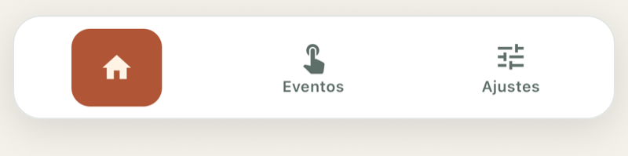
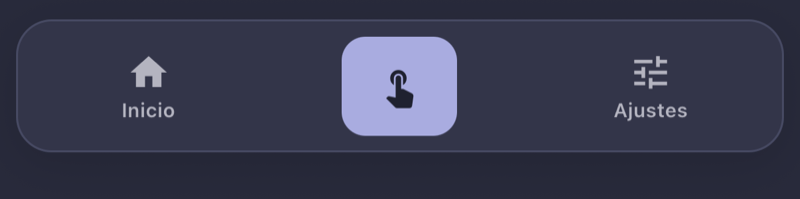

# @acertijosapps/react-native-bottom-tab-bar

Barra de tabs flotante y animada para [React Navigation](https://reactnavigation.org/) (`@react-navigation/bottom-tabs` v7), construida sobre Reanimated.

Página de la librería: [acertijosapps.com/librerias/react-native-bottom-tab-bar](https://acertijosapps.com/librerias/react-native-bottom-tab-bar)

<p align="center">
  
  
</p>

- Barra flotante centrada con borde, sombra y esquinas redondeadas.
- La tab activa muestra su icono dentro de una píldora de color (animación `ZoomIn`); las inactivas muestran icono + etiqueta (`FadeIn`).
- Respeta el safe-area inferior y los laterales (notch en horizontal).
- Badges con `tabBarBadge`, tabs ocultas y barra oculta por pantalla o con el teclado.
- Emite `tabPress` (cancelable) y `tabLongPress`, igual que la barra nativa de React Navigation.
- Accesible: `tablist` / `tab`, `selected` y `accessibilityLabel` por tab.
- Colores configurables, sin depender de ningún sistema de temas.
- Swipe opcional sobre el contenido para cambiar de tab (`SwipeableTabScreen`, desactivado por default).

## Instalación

```bash
yarn add @acertijosapps/react-native-bottom-tab-bar
```

Dependencias peer (ya las tienes si usas bottom-tabs y Reanimated). React Navigation debe ser v7;
algunas opciones piden bottom-tabs ≥ 7.20 (se indican en la tabla de opciones):

```bash
yarn add @react-navigation/native @react-navigation/bottom-tabs react-native-reanimated react-native-safe-area-context react-native-gesture-handler
```

## Uso

Declara la función `tabBar` **fuera** del render del navegador para no recrear el componente en cada render.

```tsx
import type { BottomTabBarProps } from '@react-navigation/bottom-tabs';
import { createBottomTabNavigator } from '@react-navigation/bottom-tabs';
import { BottomTabBar } from '@acertijosapps/react-native-bottom-tab-bar';

const Tabs = createBottomTabNavigator();

const renderTabBar = (props: BottomTabBarProps) => <BottomTabBar {...props} />;

export const AppTabs = () => (
    <Tabs.Navigator
        tabBar={renderTabBar}
        screenOptions={{ headerShown: false }}
    >
        <Tabs.Screen
            name="Home"
            component={HomeScreen}
            options={{ title: 'Inicio', tabBarIcon: HomeIcon }}
        />
    </Tabs.Navigator>
);
```

### Colores del tema

Pasa solo las claves que quieras cambiar; el resto toma `defaultColors`.

```tsx
const renderTabBar = (props: BottomTabBarProps) => (
    <BottomTabBar
        {...props}
        colors={{ accent: '#4F7A57', onAccent: '#F2F6EC' }}
        labelFontFamily="Manrope-SemiBold"
    />
);
```

Con un tema dinámico (por ejemplo `react-native-unistyles`), envuélvelo en un componente que lea el tema:

```tsx
const ThemedTabBar = (props: BottomTabBarProps): React.JSX.Element => {
    const { theme } = useUnistyles();

    return (
        <BottomTabBar
            {...props}
            colors={theme.colors}
            labelFontFamily={theme.fontFamily.sansSemiBold}
        />
    );
};

const renderTabBar = (props: BottomTabBarProps) => <ThemedTabBar {...props} />;
```

### Swipe entre tabs

`SwipeableTabScreen` envuelve cada pantalla vía la prop `screenLayout` del navegador y cambia de tab
al deslizar horizontalmente: de derecha a izquierda va a la siguiente, de izquierda a derecha a la
anterior (invertido en RTL). Los gestos verticales no lo activan, así que el scroll sigue funcionando.

Durante el gesto la pantalla actual sigue al dedo (con resistencia en la primera y la última tab).
Si el swipe no alcanza, regresa a su lugar; si alcanza, se navega y `animation: 'shift'` continúa el
movimiento. La pantalla vecina no se ve durante el arrastre: bottom-tabs solo monta la activa. El
área que se descubre es el fondo del tema de React Navigation (`theme.colors.background`), así que
conviene igualarlo al fondo de tus pantallas.
Está **desactivado por default**: actívalo con `isSwipeEnabled`.

La app debe estar envuelta en `GestureHandlerRootView`.

```tsx
import type { SwipeableTabScreenProps } from '@acertijosapps/react-native-bottom-tab-bar';
import { SwipeableTabScreen } from '@acertijosapps/react-native-bottom-tab-bar';

const renderScreenLayout = (props: SwipeableTabScreenProps) => (
    <SwipeableTabScreen
        {...props}
        isSwipeEnabled
    />
);

<Tabs.Navigator
    tabBar={renderTabBar}
    screenLayout={renderScreenLayout}
    screenOptions={{ animation: 'shift' }}
>
```

`animation: 'shift'` (bottom-tabs) hace que el cambio de tab se deslice en la dirección del gesto.

## API

### `<BottomTabBar />`

Recibe todas las `BottomTabBarProps` de React Navigation, más:

| Prop | Tipo | Default | Descripción |
| :--- | :--- | :--- | :--- |
| `colors` | `Partial<BottomTabBarColors>` | `defaultColors` | Colores de la barra; se mezclan con los defaults. |
| `labelFontFamily` | `string` | fuente del sistema, peso `600` | Familia tipográfica de las etiquetas. |
| `animationDuration` | `number` | `220` | Duración en ms de la animación al seleccionar. |

### `<SwipeableTabScreen />`

| Prop | Tipo | Default | Descripción |
| :--- | :--- | :--- | :--- |
| `children` | `ReactElement` | — | La pantalla; la entrega `screenLayout`. |
| `navigation` | `NavigationProp<ParamListBase>` | — | La navegación de la pantalla; la entrega `screenLayout`. |
| `isSwipeEnabled` | `boolean` | `false` | Activa el cambio de tab por swipe horizontal. |

El cambio ocurre si el gesto recorre al menos 60 pt o termina con velocidad ≥ 500 pt/s en la misma
dirección. En la primera y la última tab, el swipe hacia afuera no hace nada. Las tabs ocultas
(ver abajo) se saltan: el swipe va a la siguiente tab visible.

### Opciones de pantalla que se respetan

| Opción | Uso |
| :--- | :--- |
| `tabBarIcon` | Icono; recibe `focused`, `color` (`onAccent` activa / `textMuted` inactiva) y `size` (`22`). |
| `tabBarLabel` (string) · `title` | Etiqueta, en ese orden de prioridad; si no hay ninguna, el nombre de la ruta. |
| `tabBarAccessibilityLabel` | Etiqueta del lector de pantalla; por defecto, la etiqueta visible. |
| `tabBarButtonTestID` | `testID` del botón de la tab. |
| `tabBarAllowFontScaling` | Escalado de fuente de la etiqueta; crece hasta 1.5× y se corta en una línea. |
| `tabBarRepeatedPressBehavior` | `scrollToTop` / `popToTop` al tocar de nuevo la tab activa (bottom-tabs ≥ 7.20). |
| `tabBarBadge` | Texto o número del badge sobre el icono; también lo lee el lector de pantalla. |
| `tabBarBadgeStyle` | Estilo del badge (por ejemplo `backgroundColor` y `color`); se mezcla sobre `badge` / `onBadge`. |
| `tabBarShowLabel: false` · `tabBarLabelVisibilityMode: 'unlabeled'` | Oculta las etiquetas de las tabs inactivas (`tabBarLabelVisibilityMode` pide bottom-tabs ≥ 7.20). |
| `tabBarItemStyle: { display: 'none' }` | Oculta la tab de la barra; el swipe se la salta. |
| `tabBarButton` | Botón propio de la tab; recibe las props del botón y el contenido en `children`. Si devuelve `null`, la tab se oculta. |
| `tabBarStyle: { display: 'none' }` | Oculta la barra mientras esa pantalla tiene el foco. |
| `tabBarHideOnKeyboard` | Oculta la barra mientras el teclado está abierto en esa pantalla. |

### `BottomTabBarColors`

| Clave | Default | Dónde se usa |
| :--- | :--- | :--- |
| `background` | `#F4F1EA` | Fondo detrás de la barra (incluye el safe-area). |
| `surface` | `#FFFFFF` | Fondo de la barra. |
| `border` | `#E1E5E2` | Borde de la barra. |
| `accent` | `#B05636` | Píldora de la tab activa. |
| `onAccent` | `#FFF3E5` | Icono de la tab activa. |
| `textMuted` | `#5E6E68` | Icono y etiqueta de las tabs inactivas. |
| `shadow` | `#000000` | Color de la sombra. |
| `badge` | `#C8302A` | Fondo del badge (opcional). |
| `onBadge` | `#FFFFFF` | Texto del badge (opcional). |

## Desarrollo

```bash
yarn install
yarn typecheck && yarn lint && yarn format:check && yarn test
yarn build
```

## Example (Expo)

`example/` es una app Expo SDK 57 que corre en Expo Go y consume la librería **desde `src/`**:
los cambios en la librería se ven con Fast Refresh, sin `yarn build`.

```bash
yarn example install
yarn example ios
```

Tres tabs visibles y una oculta:

- **Inicio**: qué hace la barra, con un botón que abre la tab oculta.
- **Detalle** (oculta): usa `tabBarItemStyle` y `tabBarStyle` con `display: 'none'`; el swipe se la salta.
- **Eventos**: cuenta `tabPress` y `tabLongPress`; el badge de la tab muestra el conteo.
- **Ajustes**: activa el swipe, cambia `colors` en vivo (patrón de tema dinámico por contexto) y
  tiene un campo de texto para probar `tabBarHideOnKeyboard`.

`example/metro.config.js` resuelve la librería desde `../src` y bloquea el `node_modules` de la raíz
para que React y los peers se carguen una sola vez.

## Autor

Hecho por [AcertijosApps](https://acertijosapps.com/librerias). Conoce el resto de nuestras
librerías en [acertijosapps.com/librerias](https://acertijosapps.com/librerias).

Dudas o propuestas: [acertijos.contacto@gmail.com](mailto:acertijos.contacto@gmail.com) o abre un
[issue](https://github.com/acertijosapps/react-native-bottom-tab-bar/issues).

## Licencia

MIT
